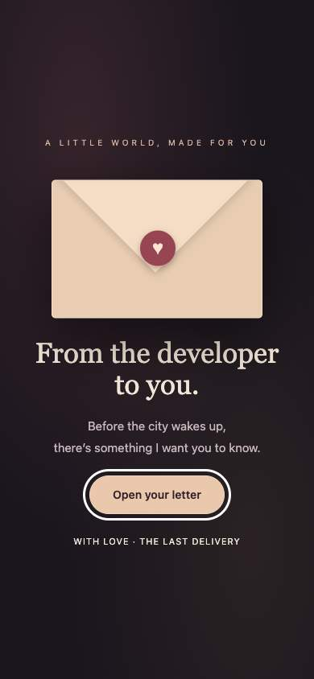
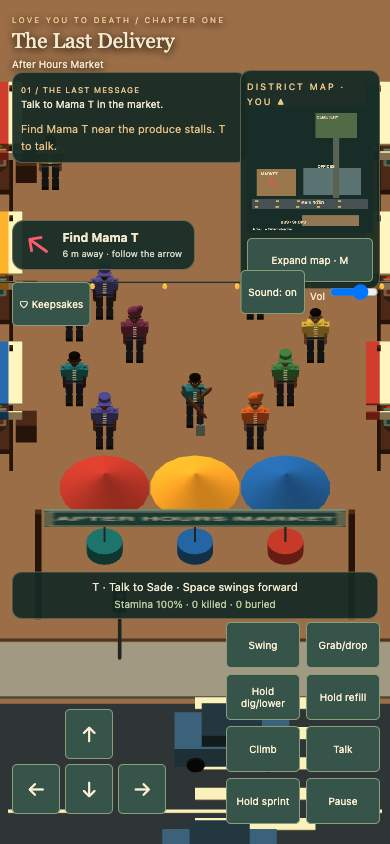
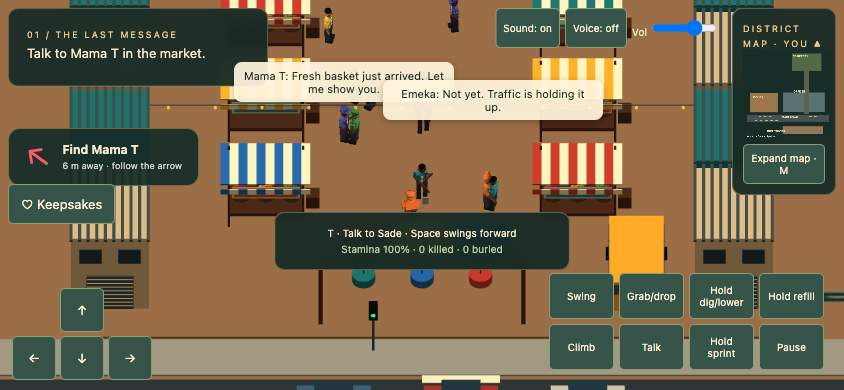
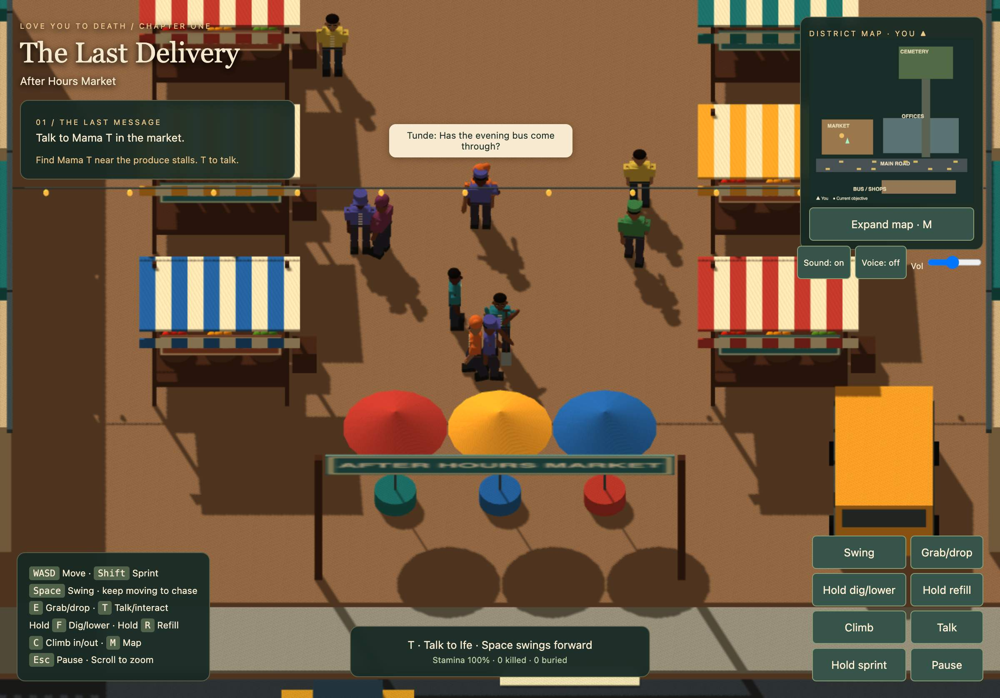
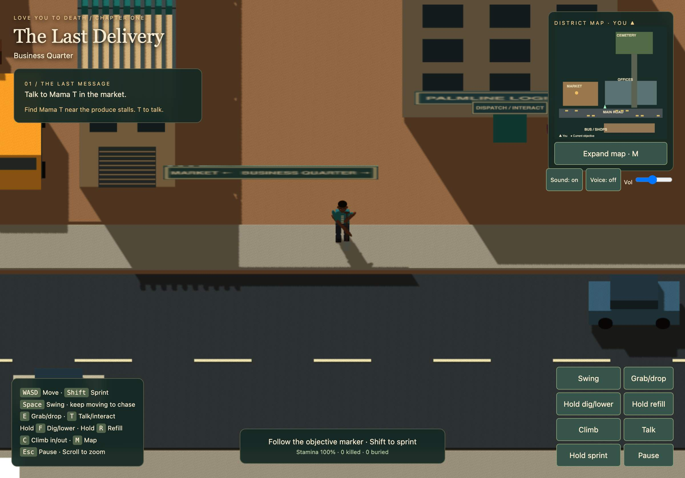
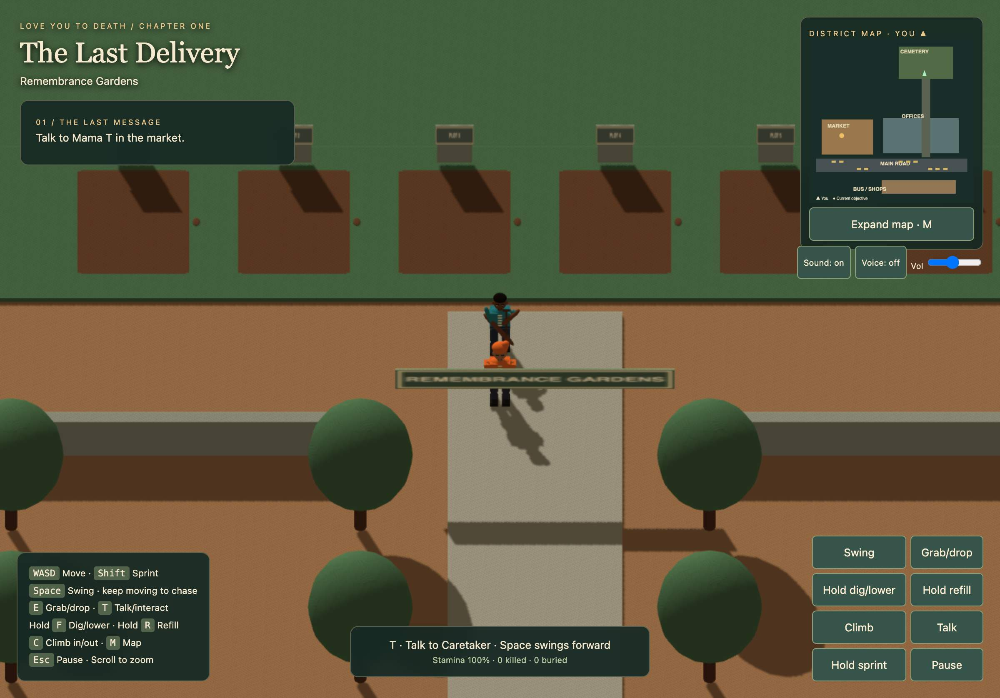
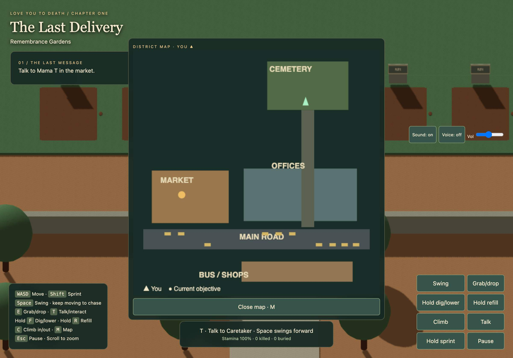
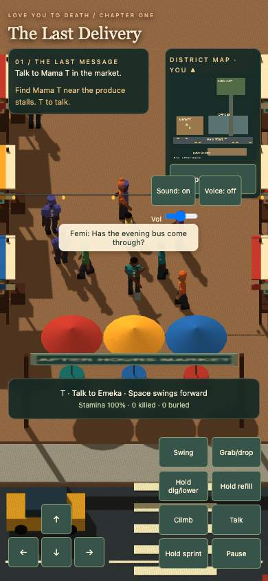

# Love You to Death — The Last Delivery

A story-driven, Lagos-inspired district prototype with a market, offices, moving traffic, roadside shops and a separate cemetery.

## Demo 0.5 — November 20, 2026

**[Play the live demo](https://love-you-to-death.vercel.app)** — deployed to Vercel from [GitHub](https://github.com/okiv21/love-you-to-death). GitHub, Vercel and Supabase connections verified; no Supabase database is required or changed.

New: opening envelope and romantic letter, a persistent objective arrow with distance, red player/objective map markers, an original synthesized tension soundtrack, six additional residents (23 NPCs total), portrait/landscape touch layouts, and a keepsake gallery that unlocks one reward per takedown. Reward counts persist on the same browser. Nine supplied keepsakes (eight JPEG photos and one GIF) are included. Each unlocked image has Download photo and Open full size controls. Original files are preserved and loaded lazily.

Performance: 689 scenery render components are statically batched; characters and traffic are dynamically batched, shadows disabled, mobile pixel ratio capped at 1, and mobile rendering targets 30 fps. Paused screens stop requesting new scene renders. The local market measurement after character batching averaged 243 draw calls over 60 rendered frames. This is not a guarantee of real-phone frame rate.

Validation: 35 gameplay and 15 gift/navigation regression checks pass; portrait 390×844 and landscape 844×390 layouts inspected; no browser console errors observed. A physical-phone playtest and human listening check remain outstanding.


*Portrait opening: a warm paper envelope and wax-heart seal introduce the personal letter.*


*Portrait controls, objective direction arrow, red map markers and keepsake access. Captured during this demo's UI validation.*


*Landscape phone playtest; movement controls remain visible. Objective and arrow panels have separate space.*

To add personal photo rewards, put JPEG/PNG/WebP files in `dist/rewards/` and list them in `dist/rewards/photos.json`, for example `[{"src":"/rewards/photo-01.jpg","caption":"Thinking of you."}]`. Photos included in this public demo are accessible to visitors; the gallery unlock is a game mechanic, not access control.

Build with `npm run build`; run `npm run check` for syntax validation. No npm runtime dependencies are needed. The Node and Python build tools concatenate the same five source modules. The published root redirects to the current 3D game, not the older 2D prototype.

Release evidence: [50 browser checks](artifacts/demo-qa.json), [published-file verification](artifacts/demo-public-assets.json). Public assets match the local build byte-for-byte and require no login. Automated browser navigation to the public domain timed out, so an end-to-end public browser playtest remains unverified. Photo-update runtime commit: `ff009f3`; deployment ID: `dpl_A8A4RERAvW1QBJUG3PR8pBsjNRZW`. No backend runtime, database or paid resources added. The latest gift demo and photo-download code have now been synchronized to PlayCanvas script asset 316697723. Editor Launch uses the public reward URLs; the standalone app uses same-origin files. Script parsing succeeded and checkpoint `ed6a825e-0f38-4f00-ae34-ca221a7f0836` was saved. Launch verification was blocked by Chrome’s popup setting.

## Play
Open **http://localhost:4173/sandbox/** while the local preview is running. To start it yourself:

```bash
cd "$HOME/Documents/FUN PROJECTS/love-you-to-death"
python3 preview.py
```

You can also [open the current game directly](dist/sandbox/index.html) in Chrome. Click **Begin shift** to start the story and enable sound. Keep the browser beside Codex; refresh after source changes. The PlayCanvas engine is bundled locally, so this version works without a CDN connection.

WASD moves; Shift sprints; Space swings; E grabs/releases; T talks/interacts; M expands the location map. Hold F to dig or lower a body. Hold R to replace soil. C climbs in/out. Touch buttons provide equivalent controls.

## What changed in 0.4
Hands now follow the shovel grip and body-drag grips. Pursuit continues during swings; blade contact, facing and obstacles determine hits. Grave actions are separate and reversible. The world has four connected districts, live map markers, traffic signals/queues, NPC exchanges and sound. The story follows Nia's last message through four objectives to a playable ending.

## Project documents
- [Story and mission flow](STORY.md)
- [Source, controls, verification and known limits](playcanvas/README.md)
- [Design history](GAME_DESIGN.md)
- [Detailed goals](GOALS.md)
- [References and asset provenance](REFERENCES.md)
- [Browser regression checks](tests/district-browser.js) and [recorded results](artifacts/district-qa.json)

## Current screenshots

*Market district with objective panel, NPC conversation bubbles and live location map.*


*Main road separates the shops/bus-stop area from the business quarter. Ten vehicles move and queue. Captured before the final visual signal poles were added.*


*Remembrance Gardens sits beyond the green corridor, away from the market. The map marks the player's position at its entrance.*


*Expanded map shows market, offices, main road, roadside shops, cemetery, player and objective. Camera positions in these screenshots were staged for inspection.*


*390×844 emulation: location map, dialogue, sound controls and separate touch actions for digging, refilling and climbing.*

## Earlier visual artifacts
- [Market 0.3 desktop](artifacts/market-desktop.jpg): earlier close market view.
- [Market 0.3 overview](artifacts/market-overview.jpg): the former layout with graves directly behind stalls.
- [Market 0.3 mobile](artifacts/market-mobile.jpg): prior touch HUD.
- [Graveyard 0.2](artifacts/midnight-grounds-desktop.png): initial primitive cemetery.
- [Original letter-only game](dist/index.html): archived interactive prototype at the root URL.

## PlayCanvas and hosting status
Build 0.4 is synchronized to [The Last Delivery — Lagos District](https://playcanvas.com/editor/scene/2659799). Editor Launch initialized successfully on PlayCanvas 2.23.3/WebGL2; courier and ten traffic entities were confirmed. Click Begin shift in the Launch window. No runtime errors were reported; one Editor-generated deprecated camera `offscreen` option warning remains. Checkpoint: `25795383-8861-42b3-897c-abd8bc96cb73`.

`netlify.toml` publishes `dist`; the current game is at `/sandbox/`. No production deployment has occurred. Prototype art remains stylized, and full physical ragdolls, detailed interiors and persistent saves remain future work.
